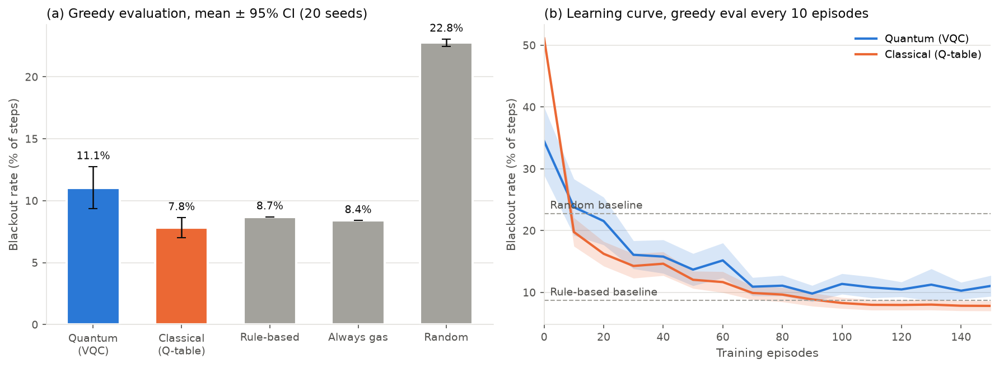

# Grid Optimization using Quantum-Enhanced Reinforcement Learning

A 30-parameter variational quantum circuit (VQC) Q-learning agent, a classical Q-table agent and three fixed baselines manage a toy electric grid, scored on blackout rate over 20 random seeds.

## Results



Greedy evaluation (epsilon = 0) on 100 fixed-seed episodes (2,000 steps) after 150 training episodes, repeated over 20 seeds:

| Agent | Parameters | Blackout rate (mean ± 95% CI, 20 seeds) |
|---|---|---|
| Quantum (VQC) | 30 | 11.1% ± 1.7 |
| Classical (Q-table) | 3,125 | **7.8% ± 0.8** |
| Rule-based (boost gas when supply looks tight) | 0 | 8.7% ± 0.0 |
| Always boost gas | 0 | 8.4% ± 0.0 |
| Random | 0 | 22.8% ± 0.3 |

**What this means:**

- **The quantum agent does not beat the classical agent.** The intervals don't overlap, and the classical Q-table has the lower blackout rate.
- **The quantum agent also does worse than both fixed baselines on average.** Its median seed (9.4%) is close to the baselines, but 5 of the 20 seeds stay at 13–22%. Training the VQC is less reliable.
- **The classical agent is the only learned agent that beats the rule-based baseline**, and only narrowly: 7.8% ± 0.8 vs 8.7%. So the claim that fixed rules "fail in unusual conditions" is weakly supported for the Q-table, and not at all for the VQC.
- The two baselines have ± 0.0 because they are deterministic and every seed is scored on the same fixed evaluation episodes.

The 95% interval is `1.96 * std / sqrt(20)`, using the sample standard deviation (ddof = 1).

**Before vs after.** The original code reported 1 quantum vs 4 classical blackouts over 60 training episodes, from one seed. That snapshot is in `results_v0.npz`. The number reflected noise and exploration, not policy quality: a random policy blacked out only 0.3% of steps on the original grid, and the agent never saw the demand its action had to meet (see below).

## How to run

```bash
python3 -m venv .venv && source .venv/bin/activate
pip install -r requirements.txt

python check_env.py     # random-policy blackout rate (sanity check on difficulty)
python experiment.py    # 20 seeds in parallel (~6 min on 10 cores) -> experiment.npz, results.md
python plot.py          # results.png
python train.py         # single-seed training run (quick look)
streamlit run app.py    # interactive demo
```

## What the environment is

`grid_env.py` is a Gymnasium environment. Each episode has 20 hourly steps.

- **Observation:** `[solar, wind, gas, demand]`, each in [0, 1].
- **Actions:** do nothing, boost gas, curtail demand, draw from battery, charge battery.
- **Rewards:**
  - +2 if supply meets demand, with a +0.5 bonus when solar + wind > 0.6
  - −5 for a blackout
  - −1 for curtailing demand

**Difficulty settings.** These were tuned so a random policy blacks out about 22% of steps (the target was 15–30%):

| Setting | Original | Now |
|---|---|---|
| Wind | uniform(0.1, 0.9) | uniform(0.0, 0.6) |
| Demand baseline | 0.5 | 0.9 |
| Peak solar | 1.0 | 0.3 |
| Random-policy blackout rate | 0.3% | 21.8% |

Raising demand alone wasn't enough, because demand is clipped to [0, 1] and midday solar kept supply ahead.

**Fixes compared with the original version:**

1. **Timing bug.** `step()` used to draw a new random observation and score the action against it, so the agent never saw the demand its action had to meet. It now scores the action against the observation the agent acted on, then draws the next one.
2. **Q-value range.** Pauli-Z expectation values lie in [−1, 1], but the targets reached about 50. Now all rewards are divided by 5 (`REWARD_SCALE` in `train.py`), gamma is 0.9, and the circuit outputs are multiplied by 5 (`Q_SCALE` in `vqc_agent.py`), so Q-values span [−5, 5]. The same reward scaling and gamma apply to the classical agent for fairness.
3. **Exploration.** Epsilon decays by 0.97 per episode. Training now runs 150 episodes (0.97¹⁵⁰ < 0.05), so epsilon reaches its 0.05 floor. Before, it stopped at 0.16 after 60 episodes.
4. **Evaluation.** Agents used to be scored on training-time blackouts, which include random exploration. They are now scored by a greedy evaluation on fixed seeds, repeated over 20 training seeds.

## What this does not show

- **No quantum hardware.** The circuit is simulated on a classical computer with PennyLane's `default.qubit`. Nothing here says anything about speed or advantage on real devices.
- **Toy grid.** There are 4 state variables, 5 actions and 20-step episodes. The battery level isn't observed, and boosted gas never ramps back down, so "boost gas" is nearly always a safe choice. That is why the always-gas baseline is so strong.
- **Very different model sizes.** The VQC has 30 trainable parameters (2 layers × 5 qubits × 3 angles). The Q-table has 3,125 (5⁴ states × 5 actions). A smaller model is not evidence of an advantage unless it also performs better, and here it doesn't.
- **Little tuning.** Learning rates, circuit depth and the reward/Q scaling were not tuned for either agent. A better-tuned VQC might close the gap.

## Structure

```
grid_env.py        # Gymnasium grid environment (difficulty settings at the top)
vqc_agent.py       # Variational quantum circuit Q-learning agent (30 params)
classical_agent.py # Q-table agent (3,125 entries)
baselines.py       # Random, always-gas and rule-based agents
check_env.py       # Random-policy blackout rate
train.py           # Single-seed training loop + shared settings
experiment.py      # 20-seed greedy evaluation and learning curves
plot.py            # results.png from experiment.npz
app.py             # Streamlit demo
```
